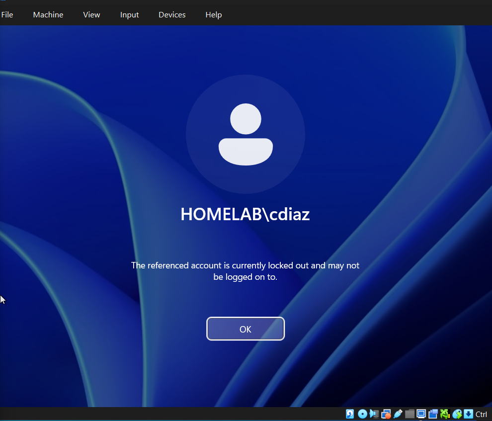
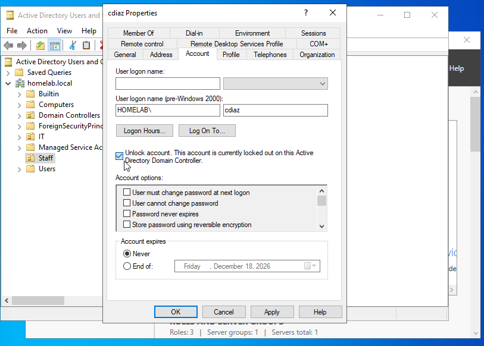
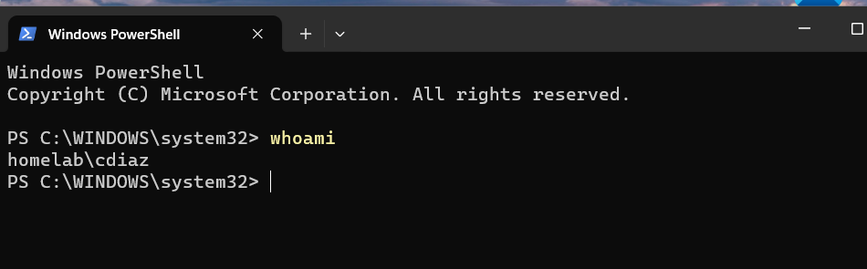

# Day 3: Joining a Windows 11 Client to the Domain
Date: 2026-11-17

## Task
Get the Windows 11 client VM (CLIENT01) running, join it to the homelab.local domain, sign in as a domain user, and test the account lockout policy.

## Challenges
- CLIENT01 stayed on a black screen when it started.
- Windows 11 Setup reported that the PC did not meet the requirements because the VM had less than 4 GB of memory.
- The client could not reach the domain controller at first. Ping returned "Destination host unreachable".
- With limited RAM on the laptop, both VMs ran slowly.

## How I solved it
Black screen:
- Checked the VM settings (UEFI, Secure Boot, the attached ISO and the display options).
- Changed the graphics controller from VBoxSVGA to VMSVGA with 3D acceleration off. The VM then started.

Windows 11 requirements message (a workaround for a lab VM, not for real machines):
- Opened a command prompt in Setup with Shift+F10 and added a registry setting that bypasses the RAM check:
```
reg add HKLM\SYSTEM\Setup\LabConfig /v BypassRAMCheck /t REG_DWORD /d 1 /f
```
- Went back one step in Setup and continued the installation.

Reaching the domain controller:
- Checked that DC01 was running and tested again with ping.
- Pointed the client's DNS at DC01 and checked the result:
```powershell
Set-DnsClientServerAddress -InterfaceAlias "Ethernet" -ServerAddresses 10.0.2.5
nslookup homelab.local
```
- `nslookup` returned 10.0.2.5 for homelab.local.

Joining the domain:
```powershell
Add-Computer -DomainName homelab.local -Credential HOMELAB\Administrator -Restart
```
- After the restart, I signed in as HOMELAB\cdiaz and confirmed it with `whoami`, which showed homelab\cdiaz.

Testing the lockout policy:
- On the client, entered a wrong password for HOMELAB\cdiaz three times. The next attempt showed "The referenced account is currently locked out and may not be logged on to."
- On DC01, opened the user's properties in Active Directory Users and Computers, went to the Account tab, ticked "Unlock account" and clicked OK.
- Signed in again from the client with the correct password and it worked.

## Skills and lessons
- Troubleshooting a VM that won't display by checking the VM's graphics and firmware settings
- Pointing a client at a domain controller's DNS and testing with `nslookup`
- Joining a Windows 11 computer to an Active Directory domain with PowerShell
- Testing a lockout policy end to end and unlocking an account
- Reading error messages carefully: "Destination host unreachable" meant the target was not reachable, not packet loss


## Evidence



